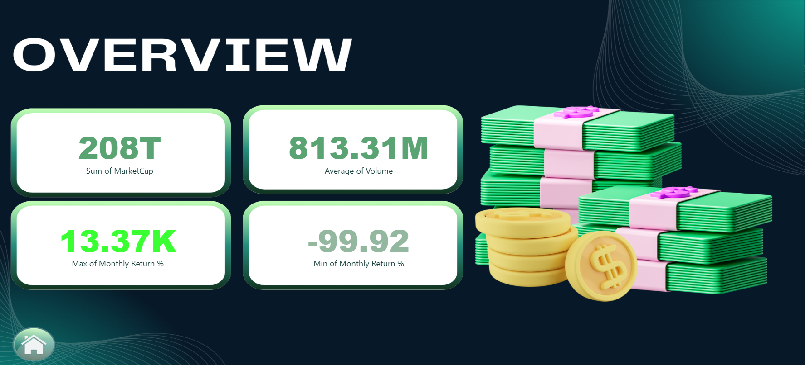
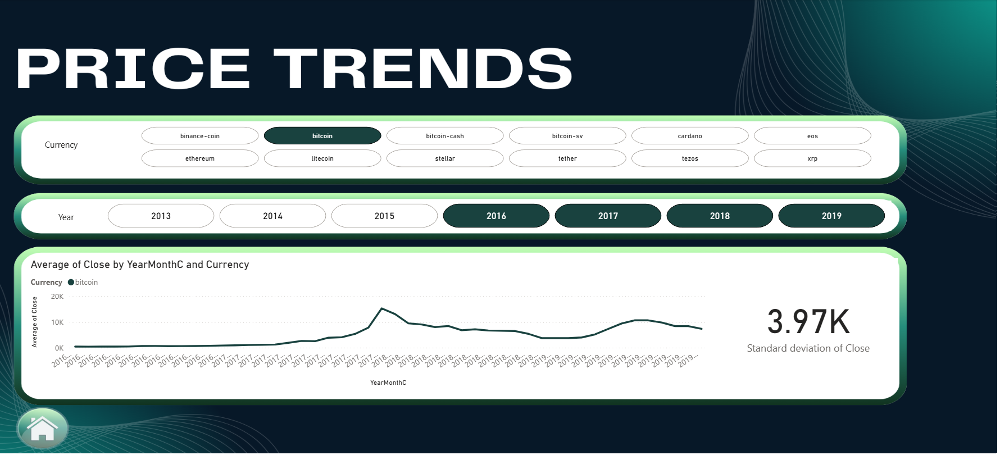
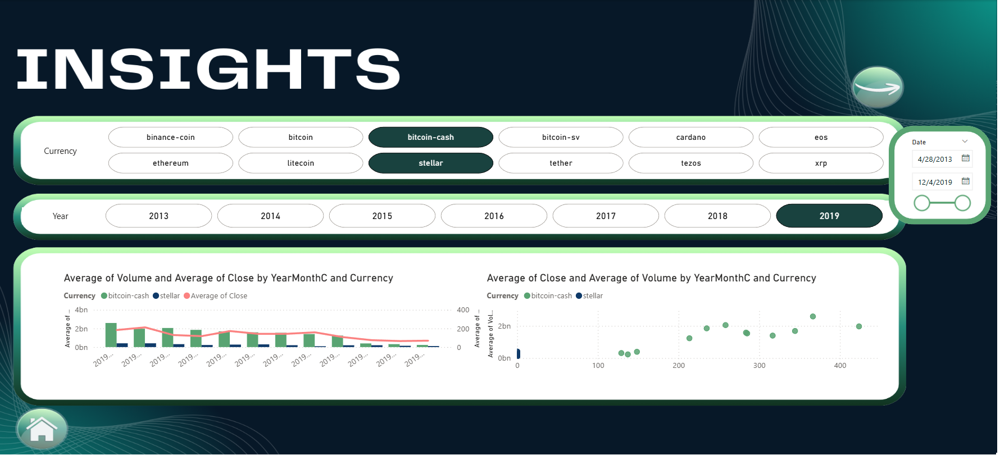

# Cryptocurrency Market Analysis Dashboard

An interactive **Microsoft Power BI** dashboard for exploring cryptocurrency market data, tracking price movements, comparing assets, and identifying market trends.

> **Project file:** `hw2_DashBoard.pbix`

## Dashboard pages

The report contains nine pages:

| Page | Purpose |
|---|---|
| Main | Landing / navigation page |
| OverView | High-level market overview and KPI cards |
| Price Trends | Cryptocurrency price movement over time |
| Comparison | Compare selected assets and their price trends |
| Comparison 2 | Additional comparative charts, including bar charts |
| Insights | Deeper analysis using combined charts and scatter plots |
| Insights2 | Additional analytical views, including pie and waterfall charts |
| Insights3 | Trend analysis with stacked-area visualizations |
| Data Added | Additional analysis and visual exploration |

## Features

- KPI cards for quick market summaries
- Interactive slicers and filters
- Historical price trend analysis
- Side-by-side cryptocurrency comparisons
- Bar, line, scatter, pie, waterfall, ribbon, and area charts
- Multiple report pages for overview, comparison, and deeper insights

## Technology

- **Microsoft Power BI Desktop** — report design and interactive visualizations
- **DAX** — measures and analytical calculations
- **Cryptocurrency market dataset** — source data used by the report

## Getting started

1. Download or clone this repository.
2. Install [Power BI Desktop](https://www.microsoft.com/power-platform/products/power-bi/desktop).
3. Open `hw2_DashBoard.pbix` in Power BI Desktop.
4. If Power BI asks for credentials or a data-source location, configure the source used by the original report.
5. Use the page tabs and slicers to explore the dashboard.

## Screenshots

Add screenshots exported from Power BI Desktop to a folder named `screenshots/`, then uncomment and update the examples below:


### Main page 


### Overview


### Price trends


### Cryptocurrency comparison


### Insights



## Repository structure

```text
.
├── hw2_DashBoard.pbix(not_uploaded)
├── README.md
├── Crypto_Analytics_Report_git.pdf
└── screenshots/
    ├── main.png
    ├── overview.png
    ├── price-trends.png
    ├── comparison.png
    └── insights.png
```

Create the `screenshots/` folder and add the images when you capture them. The folder structure above is a suggested layout.

## Notes

- The `.pbix` file contains the Power BI report and its embedded model/data where applicable.
- If the report depends on external files, databases, or online sources, those sources must also be available and correctly configured for refresh.
- Screenshots are intentionally not fabricated; add captures from the actual report so the README accurately represents the project.

## Author

Amir Hossein Khoddam - contribute ah.kh.dr.mh@gmail.com 
